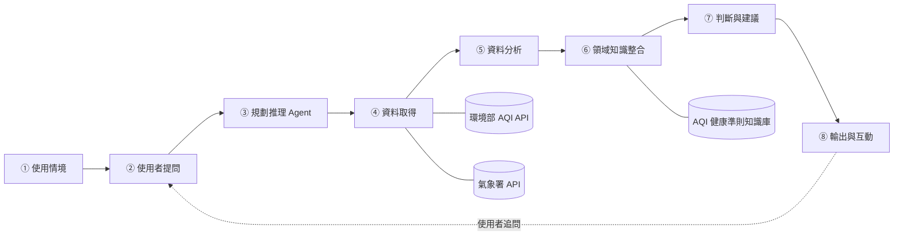

# DESIGN.md — AI 空氣品質出門顧問 Agent

> 本文件從提案階段開始建立，會隨開發進度持續更新。
> 狀態標記：✅ 已完成　🚧 進行中　⬜ 尚未開始

| 項目 | 內容 |
|---|---|
| 專題名稱 | AI 空氣品質出門顧問 Agent（Air Quality Outdoor Advisor Agent） |
| 組員 | 梁富翔、盧宜呈、曾郁欣 |
| 目前階段 | 提案 |

---

## 1. 問題（Problem）

民眾可以從環境部取得每小時更新的 AQI，但通常只看到一個數字，不知道：

- 這個數字對**自己的族群**（兒童、長者、心肺疾病者、孕婦）安不安全
- 自己要做的**活動**（散步、慢跑、騎車）適不適合
- **幾點**出門比較好
- 要不要戴口罩、戴了有沒有用（例如主要污染物是臭氧時，口罩幫助有限）

一般聊天機器人沒有即時資料，可能憑印象回答，無法查證。

## 2. 需求（Requirements）

### 功能需求

| 編號 | 需求 | 狀態 |
|---|---|---|
| F1 | 使用者可以用自然語言提問（地點、時間、族群、活動） | ⬜ |
| F2 | 資訊不足時，Agent 主動追問 | ⬜ |
| F3 | 自動找出離使用者最近的空品測站 | ⬜ |
| F4 | 取得即時 AQI、主要污染物與近幾小時趨勢 | ⬜ |
| F5 | 取得天氣預報（風速、降雨、溫度） | ⬜ |
| F6 | 依官方 AQI 健康活動建議與使用者族群做判斷 | ⬜ |
| F7 | 建議最適合出門的時段與注意事項 | ⬜ |
| F8 | 回答中每個數字都附資料來源與更新時間 | ⬜ |
| F9 | API 失敗時改用歷史資料或鄰近測站，並標註「非即時」 | ⬜ |

### 非功能需求

- 單次回答時間目標：30 秒內
- 不提供醫療診斷；有疾病的使用者會提醒諮詢醫師
- API Key 不寫進程式碼，改用 `.env`

## 3. 系統架構（Architecture）



| 模組 | 說明 |
|---|---|
| ① 使用情境 | 家長、運動族群、長者照顧者、心肺疾病患者安排戶外活動 |
| ② 使用者提問 | 自然語言輸入，例如「台中西屯明天早上適合慢跑嗎？我有過敏性鼻炎」 |
| ③ 規劃推理 Agent | LLM 理解問題，拆成「查哪裡、查什麼時間、使用者屬於哪個族群」等子任務，決定要呼叫哪些工具 |
| ④ 資料取得 | 呼叫環境部 AQI 開放資料 API 與氣象署天氣預報 API |
| ⑤ 資料分析 | 整理數據、計算趨勢、找出主要污染物、評估各時段風險 |
| ⑥ 領域知識整合 | 從知識庫取出 AQI 分級對應的活動建議與敏感族群準則 |
| ⑦ 判斷與建議 | 產生「適不適合、幾點較好、要注意什麼」的建議 |
| ⑧ 輸出與互動 | 以白話回答並附上數據與來源，使用者可以追問 |

## 4. 元件（Components）

| 元件 | 職責 | 預計檔案 |
|---|---|---|
| Agent 主程式 | 管理對話、呼叫 LLM、執行工具 | `src/agent.py` |
| 意圖解析 | 從問題取出地點、時間、族群、活動強度、時長 | `src/intent.py` |
| 測站工具 | 依經緯度找最近 k 個測站 | `src/tools/stations.py` |
| 空品工具 | 即時與歷史 AQI 查詢 | `src/tools/aqi.py` |
| 天氣工具 | 鄉鎮天氣預報查詢 | `src/tools/weather.py` |
| 分析模組 | 趨勢、主要污染物、時段風險評分 | `src/analytics.py` |
| 知識庫 | 官方準則整理成結構化資料 | `knowledge/guidelines.json` |
| 來源檢查 | 確認回答中的數字都能對應到取得的資料 | `src/verify.py` |
| 介面 | 簡單網頁（Streamlit） | `app.py` |

## 5. 資料（Data）

| 資料 | 來源 | 更新頻率 | 用途 |
|---|---|---|---|
| 空氣品質指標(AQI) | 環境部環境資料開放平臺（需 API Key） | 每小時 | 即時判斷 |
| AQI 歷史資料 | 環境部環境資料開放平臺 | 每小時 | 備援、測試題庫、比較實驗 |
| 鄉鎮天氣預報 | 中央氣象署開放資料平臺（需授權碼） | 依平臺公告 | 判斷擴散條件與降雨 |
| AQI 健康活動建議 | 環境部空氣品質監測網公告 | 不定期 | 知識庫 |

主要欄位（AQI）：`sitename`、`county`、`aqi`、`pollutant`、`status`、`pm2.5`、`o3_8hr`、`wind_speed`、`publishtime`、`longitude`、`latitude`

### 資料流

```
使用者問題 → 意圖解析 → 找測站 → 取得 AQI ＋ 天氣 → 分析 → 套用準則 → LLM 產生建議 → 來源檢查 → 輸出
```

## 6. AI 模型（AI / Analytics）

| 用途 | 模型 | 說明 |
|---|---|---|
| 主要推理 | 雲端 LLM API（如 Gemini） | 理解問題、規劃工具呼叫、產生建議 |
| 比較實驗 | 本地模型（Ollama 執行 7B 等級，如 Qwen 2.5 7B） | 比較正確率與回應時間 |
| 時段風險評分 | 規則＋加權分數 | 依 AQI、主要污染物、族群、活動強度、時長計算 |

## 7. 領域知識（Domain Knowledge）

系統設計依據五個核心思維：

1. **暴露量＝濃度×時間×呼吸量**：要問活動強度與時長
2. **不同族群敏感度不同**：建立使用者輪廓，套用敏感族群準則
3. **看主要污染物，不只看數字**：PM2.5 與臭氧的高峰時段與防護方式不同
4. **空品是動態且在地的**：用最近測站、趨勢與天氣預報
5. **風險溝通要能行動**：給「時段＋做法」，不只說不要出門

已知爭議（設計時需注意）：

- 空汙天要不要運動：一般濃度照常，高濃度縮短時間、降低強度
- 官方測站與低成本感測器：以官方測站為準
- AQI 是否足以代表健康風險：對外溝通用 AQI，分析時參考多種污染物

## 8. 演算法（Algorithm）

```
Algorithm 1: 空氣品質出門顧問 Agent
Input : 使用者問題 Q
Output: 建議 R（時段、注意事項、資料來源）

01: P ← ParseIntent(Q)                 // 地點、時間、族群、活動強度
02: while P 缺少必要資訊 do
03:     P ← P ∪ AskUser(缺少的欄位)
04: S ← NearestStations(P.地點, k = 3)
05: A ← GetAQI(S, P.時間)                // 環境部 API
06: if A 取得失敗 then A ← GetAQIHistory(S); 標註「非即時」
07: W ← GetForecast(P.地點, P.時間)       // 氣象署 API
08: T ← AnalyzeTrend(A, W)               // 趨勢、主要污染物
09: G ← RetrieveGuideline(KB, T, P.族群)
10: for each 時段 t in P.時間範圍 do
11:     risk[t] ← Score(T[t], P.族群, P.強度, P.時長)
12: best ← 風險最低的時段
13: repeat R ← LLM.Generate(P, T, G, best)
14: until R 中每個數字都能對應 A 或 W
15: R ← R ＋ 資料來源、更新時間、不確定性說明
16: return R
```

## 9. 實作對應（Implementation Mapping）

| 虛擬碼行號 | 對應程式 | 狀態 |
|---|---|---|
| 01–03 | `src/intent.py` | ⬜ |
| 04 | `src/tools/stations.py` | ⬜ |
| 05–06 | `src/tools/aqi.py` | ⬜ |
| 07 | `src/tools/weather.py` | ⬜ |
| 08–12 | `src/analytics.py` | ⬜ |
| 09 | `knowledge/guidelines.json` | ⬜ |
| 13–15 | `src/agent.py`、`src/verify.py` | ⬜ |

## 10. 執行方式（How to Run）

> 🚧 實作後補上。預計：

```bash
pip install -r requirements.txt
cp .env.example .env    # 填入 MOENV_API_KEY、CWA_API_KEY、LLM_API_KEY
streamlit run app.py
```

## 11. 評估規劃與結果（Experiments / Results）

| 項目 | 內容 |
|---|---|
| 測試題庫 | 約 30 題台灣情境題（不同地點、時段、族群、活動），以環境部歷史資料作為判斷依據 |
| 比較對象 | ① 規則式：只看 AQI 等級　② 一般 LLM：不連網、無工具　③ 本系統（雲端模型／本地模型） |
| 評估指標 | 準則一致率、數據正確率、幻覺率、回應時間 |
| 結果 | ⬜ 尚未實驗（不預先填寫） |

## 12. 限制（Limitations）

- 測站分布有限，離測站遠的地點可能不夠準
- 天氣預報本身有誤差，會影響隔天建議
- 不取代醫療建議；有疾病者應以醫師意見為準
- 雲端 LLM 需要網路與 API 額度

## 13. 更新紀錄

| 日期 | 內容 |
|---|---|
| 2026-11-02 | 建立文件：問題、需求、架構、演算法、評估規劃 |
