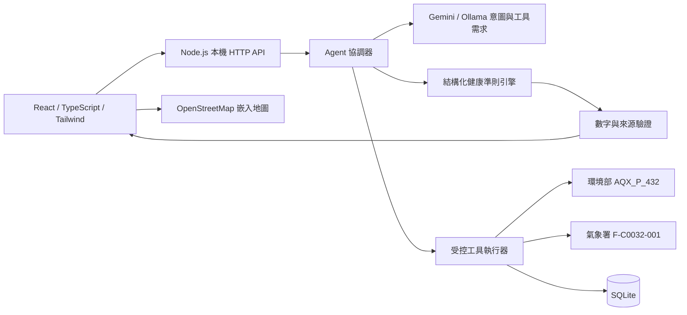
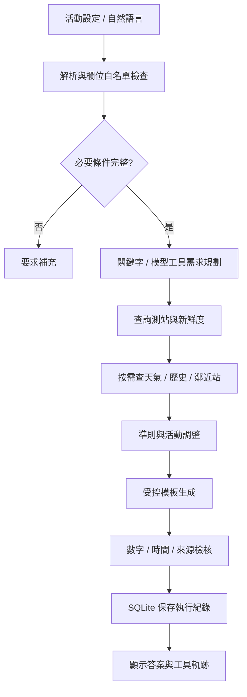
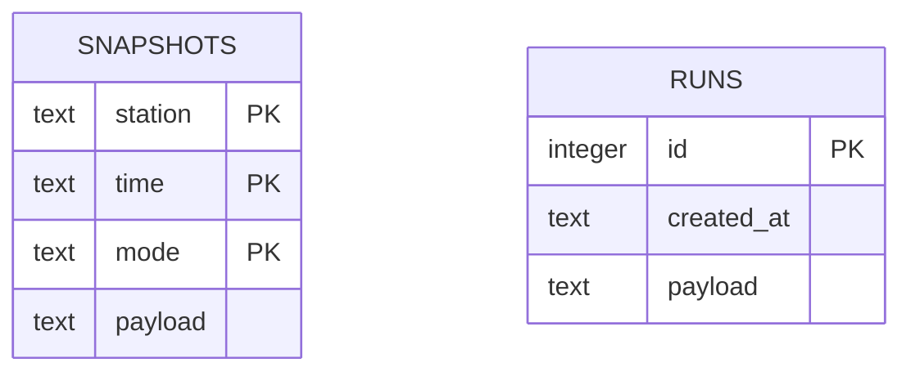

# 系統設計

2026-11-07 主要介面已改為 GeoJSON 全臺縣市地圖與語音顧問，原有五頁保留為研究模式。最新聚合規則、回答 schema、語音 adapter 與三態判斷見 REFACTOR.md；下列架構模組繼續保留。

## 範圍與工作清單

需求來源：使用者貼上的「AI 空氣品質出門顧問 Agent」與下載資料夾中的 22 頁同名提案 PPT。逐頁對照見 PPT_MAPPING.md。

| 階段 | 已完成 | 待外部設定或後續 |
| --- | --- | --- |
| 需求與規劃 | 五頁資訊架構、共用個人條件、資料／規則／工具模組分離、PPT 對照 | 持續依課程要求調整 |
| 資料串接 | 官方 HTTP adapters、欄位正規化、缺值處理、快照儲存 | 有效金鑰下的正式連線驗證 |
| 核心介面 | Dashboard、趨勢、個人設定、地圖、實驗頁面 | Leaflet 全臺多站圖層 |
| Agent | 意圖解析、按需工具、準則、結構化驗證、執行紀錄 | 更完整 function calling 與地區解析 |
| 模型切換 | Gemini／Ollama adapter、錯誤降級 | 實際金鑰與已安裝模型測試 |
| 專題實驗 | 30 題入口、快照與紀錄匯出、指標定義 | 四組系統完整 runner 與人工評分 |
| 整合驗證 | TypeScript、正式編譯、後端自動測試 | 瀏覽器端實際視覺驗證 |

MVP 為真實空品查詢、資料來源、個人化規則工具流程與可操作五頁 UI。進階項目包含可信未來空品預報、完整歷史服務、模型比較、全臺多站地圖與 Python 後端遷移。

## 架構

## 資料流

## 資料庫

快照的複合主鍵避免重複查詢同一發布時間時重複計算。runs payload 保存原始問題、問題條件、模型名稱、測站證據、工具狀態與耗時、回答及結構化驗證。測試使用記憶體 DB。

## 品質判定

AQI 直接採官方回傳值，不用單筆污染物濃度自行換算。缺值保持 null；超出 0–500 或非整數視為無效。資料時間以 Asia/Taipei 解讀；超過兩小時視為過期，這是本專題工程門檻，並非官方健康準則。

研究用活動排序指標為 min(100, AQI/5 + 族群 0/10 + 強度 0/5/10 + min(10, 分鐘/12))。缺值不評分，非醫療風險，未納入可驗證的未來空品與完整污染物權重，不用它宣稱最適出門時間。

## 環境與維護

後端選 Node.js 24，原因是目前 Windows 的 Python 啟動器與既有虛擬環境失效，而 Node 可直接使用。工具名稱與純函式邊界保留，便於日後遷移 FastAPI。服務只監聽 127.0.0.1；.env 不進版控。SQLite 與導出資料可能包含個人族群／活動資訊，僅保存於本機。
